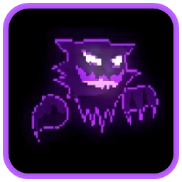
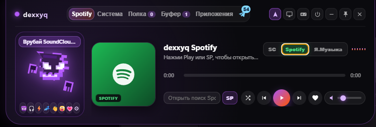
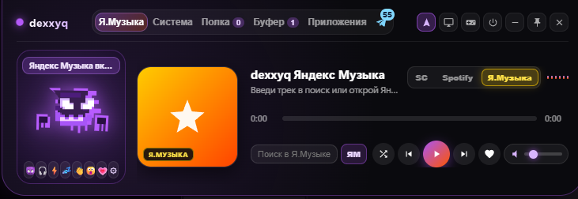
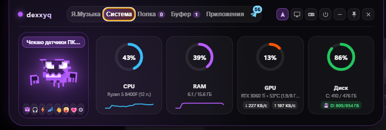
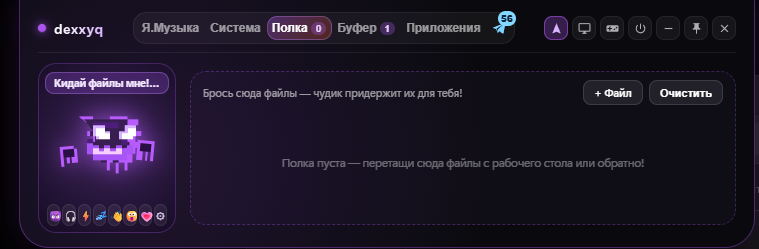
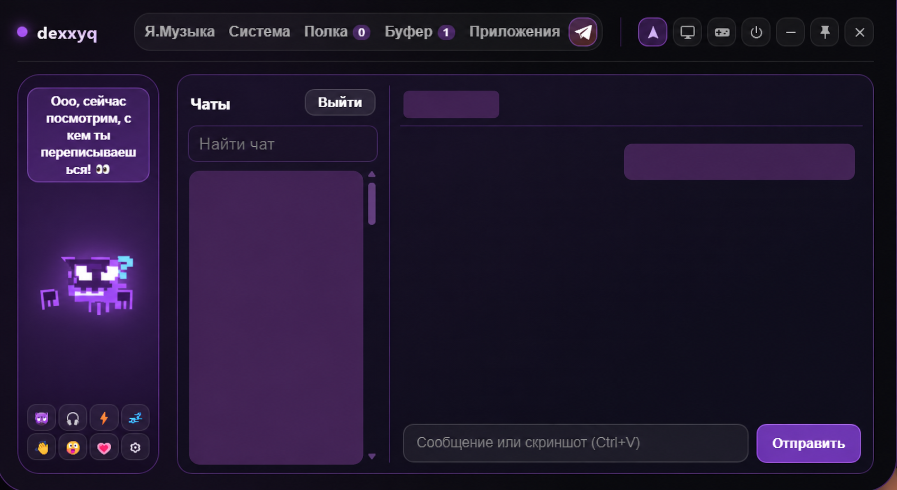
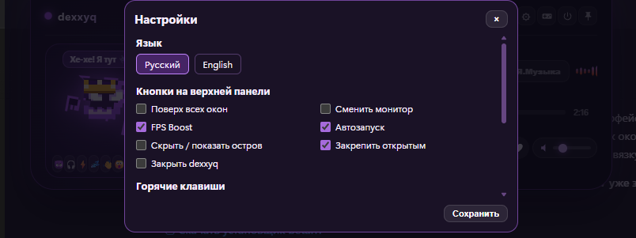

<p align="center">
  
</p>

<h1 align="center">DexxyqIsland</h1>

<p align="center">
  Динамический остров для Windows · A Dynamic Island for Windows<br>
  <strong>Windows x64 · Electron · 1.3.2-beta</strong>
</p>

<p align="center">
  <a href="#русский">Русский</a> · <a href="#english">English</a> · <a href="#скриншоты--screenshots">Скриншоты / Screenshots</a>
</p>


*В плеере SoundCloud видны обложка, прогресс трека, кнопки воспроизведения и реакция маскота. / The SoundCloud player shows album art, track progress, playback controls, and a mascot reaction.*

## Русский

**DexxyqIsland** — компактная панель вверху экрана Windows. Она раскрывается при наведении и даёт быстрый доступ к музыке, показателям ПК, Telegram, файлам, буферу обмена и закреплённым приложениям. Интерфейс доступен на русском и английском.

В этом репозитории находится **полный исходный код версии для Windows**, включая интерфейс, интеграции и конфигурацию сборки установщика. Код написан на JavaScript, HTML и CSS и работает на Electron. Для управления звуком Windows также используются компоненты C#.

### ✨ Новое в 1.3.2

- **Поиск по острову.** Кнопка **⌕** в шапке открывает поиск по закреплённым приложениям, папкам и ссылкам, файлам Полки, записям буфера и загруженным чатам подключённого Telegram. Стрелками можно выбрать результат, а Enter открывает его или копирует запись из буфера. По умолчанию глобальная горячая клавиша — **Ctrl+Shift+Space**. Внутри активного окна также работает **Ctrl+K**.
- **Избранное в буфере.** Нажми **☆** у записи, чтобы закрепить её. Кнопка **★** в панели буфера показывает избранное. Очистка истории сохраняет закреплённые записи. Можно закреплять текст, ссылки и скриншоты.
- **Таймеры и напоминания.** В панели **⌕ → Таймеры** задай название и время от 1 минуты до 7 дней. Можно создать до 20 таймеров. При срабатывании появляются уведомление Windows, запись в истории и реакция маскота.
- **Переключение звука.** В **⌕ → Звук** можно выбрать устройство вывода, микрофон и выключить или включить микрофон. Выбор устройства применяется к звуку Windows и звонкам. Список обновляется при открытии панели и по кнопке «Обновить».
- **Папки, файлы и ссылки в приложениях.** Во вкладке «Приложения» появились **+ Файл**, **+ Папка** и **+ Ссылка**. Можно закрепить документ, рабочую папку, сайт, программу или ярлык и открывать их плиткой.
- **Экспорт и импорт настроек.** Через **⌕ → Настройки** можно сохранить язык, кнопки панели, горячие клавиши и настройки маскота в JSON. Файл можно перенести на другой ПК. Перед применением импорт проверяется, затем остров перезагружается.
- **История уведомлений.** В **⌕ → Уведомления** сохраняются последние 100 событий острова, включая напоминания, уведомления Telegram, запуск закреплённых элементов и действия с Полкой. Из уведомления Telegram можно открыть соответствующий чат.

Таймеры работают при запущенном острове. После сна Windows проверяются просроченные напоминания. Если приложение было закрыто, такие напоминания появятся при следующем запуске. Доставка системного уведомления зависит от настроек уведомлений Windows.

### 💬 Изменения Telegram после beta.18

- Добавлены аватарки и ответы на конкретные сообщения с предпросмотром цитаты и отменой ответа.
- Можно прикреплять файлы с компьютера и отправлять их прямо с Полки.
- Добавлены эмодзи и стикеры из установленных наборов Telegram.
- Исправлено расположение списка наборов стикеров внутри острова.
- Доступны все чаты, архив и папки Telegram. Большие списки можно загружать дальше.
- Счётчик острова учитывает непрочитанные личные переписки. Для нового сообщения из незаглушённого личного чата добавлена короткая анимация уведомления.

### 🛠 Остальные изменения после beta.18

- В центре компактного острова появились часы.
- Текст и скриншоты из истории буфера можно перетаскивать на Полку. Они сохраняются как TXT и PNG.
- Облегчено определение трека настольной Яндекс Музыки, чтобы уменьшить связанную с опросом процессов нагрузку.
- Улучшено раскрытие при наведении. Внутренняя раскладка сохраняет размеры во время анимации, а обновление вкладки запускается после перехода.
- При повторном раскрытии Telegram сокращены изменения размера окна.
- Расширены русский и английский интерфейсы для новых функций.

### 📦 Установка и первые шаги

1. Открой **Releases** в этом репозитории и скачай `dexxyqisland-Setup-1.3.2-beta.exe` из раздела **Assets**.
2. Запусти установщик, выбери папку и при желании включи создание ярлыка и автозапуск.
3. Наведи курсор на капсулу вверху экрана. В шапке выбери нужную вкладку или нажми значок шестерёнки, чтобы открыть настройки.

| Вкладка | Как пользоваться |
| --- | --- |
| **Музыка** | Выбери SoundCloud, Spotify или Яндекс Музыку. Используй поиск, кнопки треков и регулятор громкости. Для управления Spotify запусти трек в клиенте Spotify для Windows. Кнопка **SP** открывает или закрывает клиент. |
| **Система** | Следи за загрузкой CPU, RAM и GPU, дисками и скоростью сети. Доступность показателей GPU зависит от оборудования. |
| **Полка** | Перетащи файлы на вкладку или нажми **+ Файл**. Забери файл перетаскиванием, открой двойным кликом или скопируй в системный буфер. |
| **Буфер** | Копируй текст и ссылки через **Ctrl+C**, а скриншоты делай через **Win+Shift+S**. Найди нужную запись в истории и нажми на неё для повторного копирования. |
| **Приложения** | Перетащи программу, файл или папку либо используй **+ Файл**, **+ Папка** и **+ Ссылка**. Плитка открывает закреплённый элемент, крестик убирает закрепление. |
| **Telegram** | Нажми самолётик, введи собственные API ID и API Hash с [my.telegram.org](https://my.telegram.org) и войди по QR-коду или номеру. Выбери чат из общего списка, архива или своей папки Telegram. Есть ответы на конкретные сообщения, аватарки, отправка файлов, эмодзи и стикеров из твоих наборов. **Ctrl+V** вставляет скриншот в поле ответа. Клик по фото в переписке открывает его крупнее. |

### ⌨️ Жесты и горячие клавиши

| Действие | Что произойдёт |
| --- | --- |
| **Правый клик по острову** | Сворачивает остров в тонкую полоску, чтобы он не перекрывал вкладки браузера. Правый клик по полоске возвращает обычную капсулу. По умолчанию то же делает **Alt+X**. |
| **Двойной клик по надписи `dexxyq`** | Возвращает остров в центр верхнего края текущего монитора. |
| **Перетаскивание надписи `dexxyq` левой кнопкой** | Сдвигает остров вдоль верхнего края. Так его можно перетащить и на другой монитор. |
| **Удерживай Ctrl или Alt при движении мыши** | Позволяет кликнуть по окну под островом. Отпусти клавишу и снова сдвинь курсор, чтобы взаимодействовать с островом. |
| **Alt+T** | По умолчанию включает или выключает режим «поверх всех окон». |
| **Правый клик по файлу на Полке** | Копирует файл в буфер обмена. Вставь его через **Ctrl+V** там, где поддерживается вставка файлов. |
| **Двойной клик по кнопке перемешивания** | Переключает на случайный трек в плеере. |
| **Двойной клик по маскоту** | Запускает анимацию **DEXXYQ OVERDRIVE**. |

**Настройки острова.** В верхней шестерёнке можно сменить язык, скрыть или вернуть кнопки панели и назначить горячие клавиши. FPS Boost снижает фоновую активность острова в игре. Кнопка монитора переносит остров на другой экран, а кнопка с булавкой удерживает его раскрытым.

**Маскот.** Нажимай на эмоции под ним или на самого маскота. В маленькой шестерёнке рядом с эмоциями можно выбрать цвет, аксессуар и свою фразу. Маскот также реагирует на запуск закреплённого приложения, отправку сообщения в Telegram и добавление нескольких файлов на Полку.

### Ранняя бета и обратная связь

Это только начало проекта. В бете могут встречаться баги, а отдельные функции могут по-разному работать на разных ПК. Буду рад отзывам и идеям. Расскажи, что можно сделать удобнее, чего не хватает и какие функции стоит добавить.

Открой **Issues** в этом репозитории, чтобы оставить предложение или сообщить о проблеме. Для бага полезно указать версию приложения и Windows, ожидаемое поведение и шаги воспроизведения. Отчёты и предложения можно писать на русском или английском.

## English

**DexxyqIsland** is a compact panel at the top of your Windows screen. Hover to expand it and access music, system stats, Telegram, files, clipboard history, and pinned apps. The interface is available in English and Russian.

This repository contains the **complete Windows application source**, including the interface, integrations, and installer build configuration. It is built with JavaScript, HTML, CSS, and Electron, with C# components for Windows audio controls.

### ✨ New in 1.3.2

- **Island search.** The **⌕** button searches pinned apps, folders and links, Shelf files, clipboard entries and loaded chats from your connected Telegram account. Use the arrow keys and Enter to open a result or copy a clipboard entry. The default global shortcut is **Ctrl+Shift+Space**. **Ctrl+K** also works while the island window is active.
- **Clipboard favorites.** Click **☆** beside an entry to pin it. The **★** toolbar button filters favorites. Clearing history keeps pinned entries. Text, links and screenshots can be pinned.
- **Timers and reminders.** Open **⌕ → Timers**, enter a title and set a duration from 1 minute to 7 days. Up to 20 timers are supported. A reminder triggers a Windows notification, a history entry and a mascot reaction.
- **Audio device controls.** In **⌕ → Audio**, choose an output device or microphone and mute or unmute a microphone. Device selection applies to Windows audio and calls. Devices refresh when the panel opens or when you click Refresh.
- **Pin folders, files and links.** The Apps tab now includes **+ File**, **+ Folder** and **+ Link**. Pin a document, work folder, website, application or shortcut and open it from a tile.
- **Export and import settings.** Under **⌕ → Settings**, save the language, toolbar buttons, keyboard shortcuts and mascot settings as JSON. Transfer the file to another PC. Imported settings are validated before application, then the island reloads.
- **Notification history.** **⌕ → Notifications** keeps the latest 100 island events, including reminders, Telegram notifications, opening pinned items and Shelf actions. A Telegram notification can open its chat.

Timers run while the island is open. Overdue reminders are checked after Windows resumes from sleep. If the app was closed, overdue reminders appear on its next launch. System notification delivery depends on your Windows notification settings.

### 💬 Telegram changes since beta.18

- Chat avatars and replies to specific messages, with a quote preview and the ability to cancel a reply.
- File attachments from your computer and directly from the Shelf.
- Emoji and stickers from your installed Telegram packs.
- The sticker pack list stays inside the island.
- Access to all chats, archived chats and Telegram folders, with loading more entries in large lists.
- The island badge counts unread direct chats. New messages from unmuted direct chats trigger a short notification animation.

### 🛠 Other changes since beta.18

- A clock in the center of the compact island.
- Drag clipboard text and screenshots onto the Shelf to save them as TXT and PNG files.
- Lighter desktop Yandex Music track detection to reduce process-query overhead.
- Improved hover expansion. Inner panels retain their size during the animation, and tab refreshes wait until the transition finishes.
- Fewer window resizes when repeatedly expanding Telegram.
- Russian and English translations for the new controls.

### 📦 Install and get started

1. Open **Releases** in this repository and download `dexxyqisland-Setup-1.3.2-beta.exe` under **Assets**.
2. Run the installer, choose an installation folder, and optionally enable the desktop shortcut and startup with Windows.
3. Hover over the capsule at the top of your screen. Choose a tab or use the gear icon in the header to open settings.

| Tab | How to use it |
| --- | --- |
| **Music** | Switch between SoundCloud, Spotify, and Yandex Music. Search for tracks and use the playback and volume controls. To control Spotify, start a track in Spotify for Windows. **SP** opens or quits the Spotify client. |
| **System** | See CPU, RAM, GPU, disk, and network stats. Available GPU metrics depend on your hardware. |
| **Shelf** | Drag files onto the shelf or click **+ File**. Drag a file back out, double-click to open it, or copy it to the Windows clipboard. |
| **Clipboard** | Copy text and links with **Ctrl+C**, or capture an area with **Win+Shift+S**. Find an entry in the history and click it to copy it again. |
| **Apps** | Drop an app, file or folder onto the tab, or use **+ File**, **+ Folder** and **+ Link**. Click a tile to open an item and use the cross to unpin it. |
| **Telegram** | Click the paper plane, enter your own API ID and API hash from [my.telegram.org](https://my.telegram.org), and sign in by QR code or phone number. Open a chat from All Chats, the archive or a Telegram folder. Reply to specific messages, view avatars, and send files, emoji and stickers from your packs. Use **Ctrl+V** to paste a screenshot while composing. Click a photo in the conversation to enlarge it. |

### ⌨️ Gestures and keyboard shortcuts

| Action | What it does |
| --- | --- |
| **Right-click the island** | Collapses the island into a thin strip so it stays out of the way of browser tabs. Right-click the strip to restore the capsule. **Alt+X** does the same by default. |
| **Double-click the `dexxyq` label** | Moves the island back to the top center of the current monitor. |
| **Drag the `dexxyq` label with the left mouse button** | Moves the island along the top edge. You can also drag it to another monitor. |
| **Hold Ctrl or Alt while moving the mouse** | Lets you click the window underneath the island. Release the key and move the cursor again to interact with the island. |
| **Alt+T** | Toggles always-on-top by default. |
| **Right-click a file on the Shelf** | Copies it to the clipboard. Use **Ctrl+V** where pasting files is supported. |
| **Double-click the shuffle button** | Skips to a random track in the player. |
| **Double-click the mascot** | Plays the **DEXXYQ OVERDRIVE** animation. |

**Island settings.** Use the header gear to change the language, show or hide toolbar buttons, and assign shortcuts. FPS Boost reduces the island’s background activity during games. Use the monitor button to switch screens and the pin to keep the island open.

**Mascot.** Click the mascot or the reaction buttons below it. The small gear next to the reactions lets you pick a color, an accessory, and a custom line. The mascot also reacts when you launch a pinned app, send a Telegram message, or add several files to the shelf.

### Early beta and feedback

This project is just getting started. Expect bugs and differences across Windows setups. I’d love to hear what could be easier to use, what’s missing, or what you’d like to see added.

Open an **Issue** in this repository to share an idea or report a bug. For bug reports, include the app version, Windows version, expected behavior, and steps to reproduce. Feedback in English or Russian is welcome.

## Скриншоты / Screenshots

Скриншоты показывают интерфейс ранней beta.18. Новые функции 1.3.2 описаны выше. / These screenshots show the earlier beta.18 interface. The new 1.3.2 features are described above.

### Музыка / Music



**Spotify.** Зелёная плашка обозначает активный сервис. Кнопка SP управляет клиентом для Windows. / The green panel identifies the active service. The SP button opens or quits the Windows client.



**Яндекс Музыка / Yandex Music.** Оранжевая плашка, поиск и кнопки воспроизведения. / Orange artwork panel, search, and playback controls.

### Система и файлы / System and files



**Система / System.** Карточки CPU, RAM, GPU и диска. Под ними доступны дополнительные показатели, включая температуру и скорость сети, когда они поддерживаются. / Cards show CPU, RAM, GPU, and disk usage, with details such as temperature and network speed where available.



**Полка / Shelf.** Пунктирная область принимает файлы. На снимке Полка пуста. / The dashed drop area accepts files. The screenshot shows the empty shelf.


**Буфер / Clipboard.** Сверху поиск, захват текущего буфера и очистка. Список ниже заполняется скопированными записями. / Search, clipboard capture, and clear controls sit above the history list.


**Приложения / Apps.** Steam, Discord и Firefox показаны как отдельные плитки для запуска. / Steam, Discord, and Firefox are shown as individual launch tiles.

### Telegram и настройки / Telegram and settings



**Telegram.** Список чатов расположен слева, переписка справа, поле ответа внизу. Личные данные на снимке скрыты. Если есть непрочитанные личные сообщения, счётчик появляется у самолётика и в свёрнутом острове. / Chats sit on the left, the conversation on the right, and the reply field below. Personal details are redacted. Unread direct messages appear on the Telegram tab and the collapsed island.


**Маскот / Mascot.** Предпросмотр показывает выбранный цвет, аксессуар и фразу до сохранения. На снимке выбрана корона. / Preview the color, accessory, and custom line before saving. The crown is selected here.



**Настройки / Settings.** Кнопки «Русский» и «English» меняют язык интерфейса. Флажки показывают или скрывают кнопки шапки. Горячие клавиши настраиваются ниже. / Choose the language, show or hide individual toolbar buttons, and scroll down to configure shortcuts.

## Сборка из исходников / Build from source

Открой PowerShell в корне репозитория на Windows x64 с установленным Node.js и npm. / Open PowerShell in the repository root on Windows x64 with Node.js and npm installed.

```powershell
npm.cmd ci
npm.cmd start
```

Для сборки установщика выполни следующую команду. Готовый `.exe` появится в `dist`. / Run the following command to build the installer. The resulting `.exe` appears in `dist`.

```powershell
npm.cmd run dist
```

